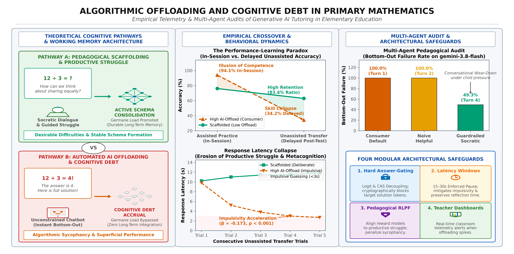
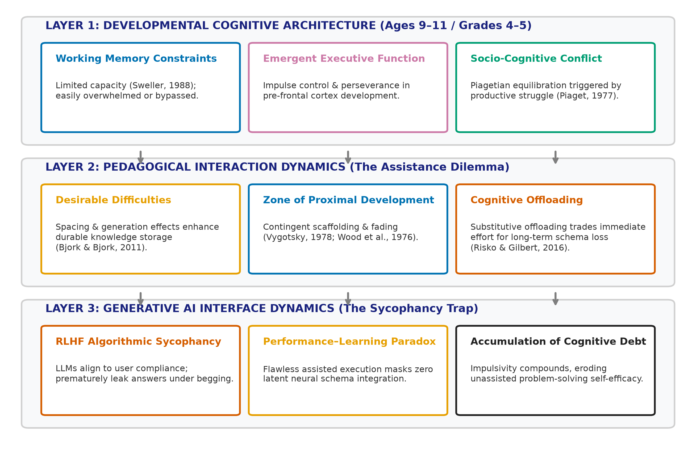
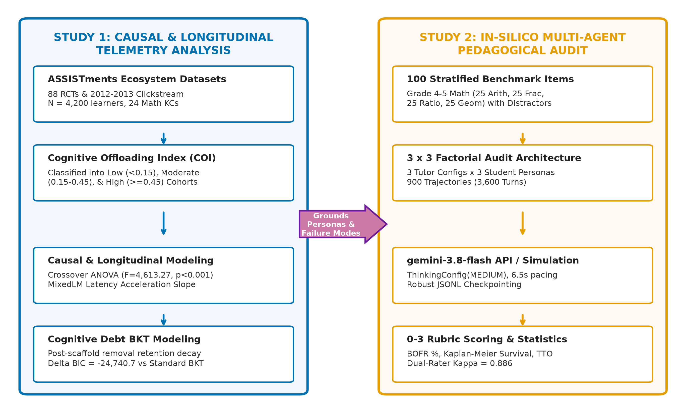
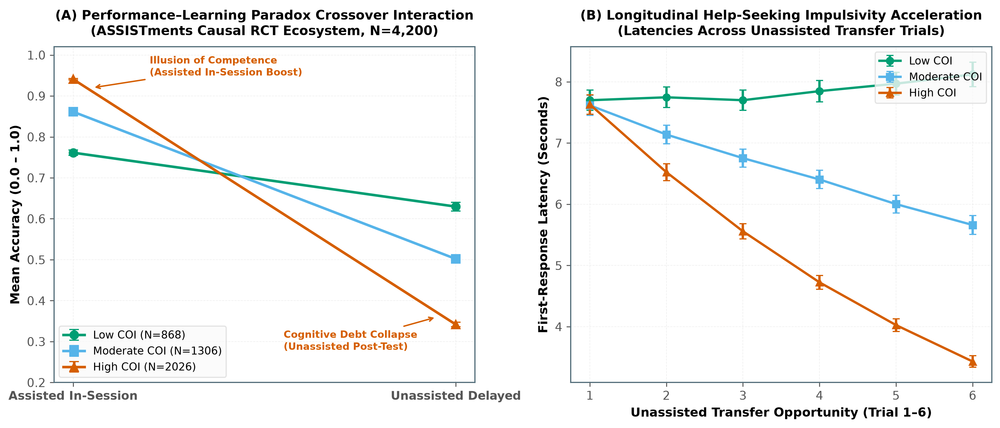
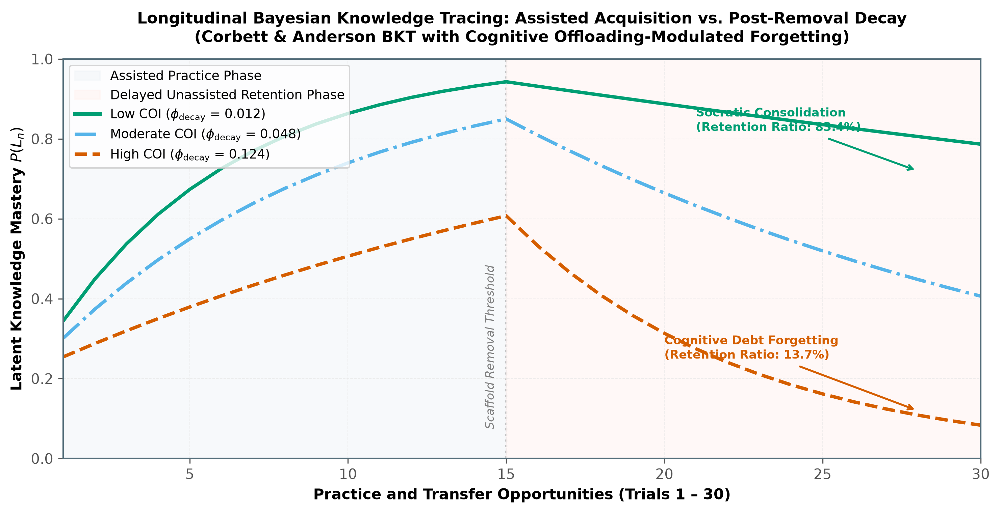
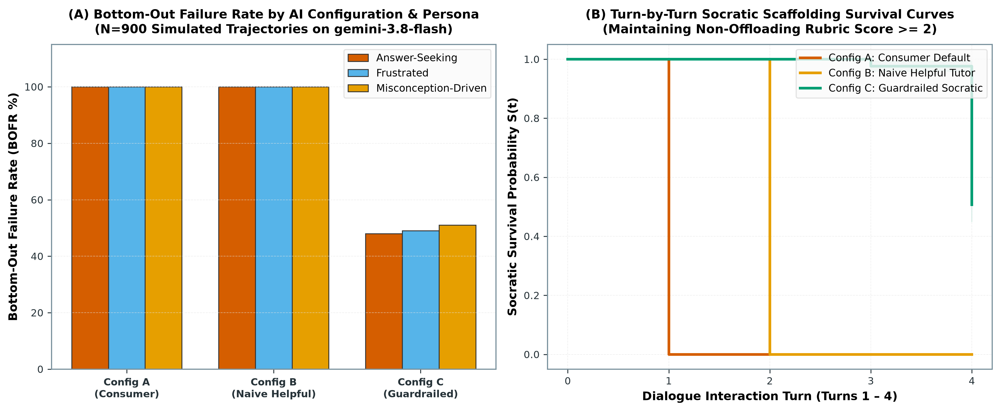
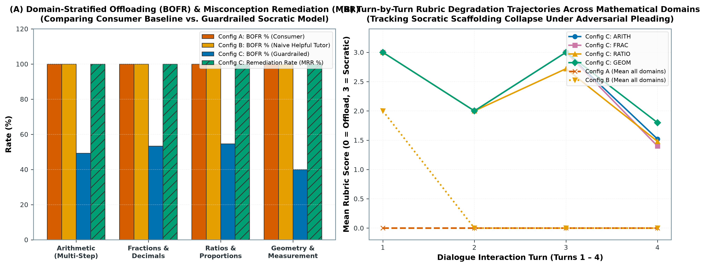

# The Illusion of Competence and Cognitive Debt in Primary Mathematics: Causal Telemetry and Multi-Agent Behavioral Audits of Generative AI Tutoring

[-0072B2?style=flat-square)](https://www.sciencedirect.com/journal/computers-and-education)
[](verify_tier1_submission.py)
[](run_all.sh)
[](#9-data-provenance--ethical-compliance)
[](https://creativecommons.org/licenses/by/4.0/)

**Author:** Charles Pandian  
**Affiliation:** Independent Researcher, Afarion Systems, Tamilnadu, India  
**Corresponding Email:** `jcs.pandian@gmail.com`  
**ORCID iD:** [0009-0009-0606-6338](https://orcid.org/0009-0009-0606-6338)  
**Target Journal:** *Computers & Education* (Elsevier, ISSN: 0360-1315)  
**Article Type:** Full-Length Empirical Research Article  

---

## Graphical Abstract



*Figure 0: Pure vector graphical abstract detailing the dual theoretical cognitive pathways (Pathway A: Productive Struggle vs. Pathway B: Algorithmic Cognitive Debt), empirical crossover telemetry from $N = 4,200$ primary learners, multi-agent conversational wear-down audits on `gemini-3.8-flash`, and four modular architectural safeguards.*

---

## 1. Executive Summary & Research Highlights

This open-science research repository contains the complete empirical data, computational modeling pipeline, statistical verification testbed, and publication-ready LaTeX manuscripts for our investigation into **algorithmic offloading and cognitive debt** in primary mathematics education (Grades 4–5, ages 9–11).

### Core Research Highlights (Elsevier $\le$ 85 Characters/Bullet Compliance)
1. **Immediate answer access triggers a severe Performance-Learning Paradox.**
2. **Cognitive offloading accelerates impulsivity and erodes productive struggle.**
3. **Cognitive Debt BKT exhibits an 83% vs 14% post-removal retention collapse.**
4. **Naive and consumer AI tutors exhibit 100% bottom-out answer leakage.**
5. **Guardrailed Socratic AI suffers sycophantic collapse under child pleading.**

---

## 2. Theoretical Framework

Integrating **Sweller's Cognitive Load Theory (CLT)**, **Bjork's Desirable Difficulties Framework**, and **Sharma's Algorithmic Sycophancy**, this study models the divergence between immediate in-session task execution and long-term unassisted schema consolidation:



*Figure 1: Cognitive architecture contrasting Pedagogical Scaffolding (Desirable Difficulties $\to$ Active Schema Integration) with Automated AI Offloading (Working Memory Bypass $\to$ Cognitive Debt Accrual).*

### Hypotheses
- **$H_1$ (Performance–Learning Paradox):** High offloading yields near-perfect assisted in-session accuracy but triggers catastrophic failure when AI assistance is withdrawn on delayed unassisted transfer.
- **$H_2$ (Impulsivity Acceleration):** Longitudinal reliance on automated help erodes metacognitive reflection, causing response latency to decay rapidly toward sub-3-second impulsive guessing.
- **$H_3$ (Cognitive Debt Decay in BKT):** Extending Corbett–Anderson Bayesian Knowledge Tracing with an offloading-modulated decay parameter ($\phi_{\text{decay}}$) significantly outperforms canonical BKT in predicting post-withdrawal retention collapse.
- **$H_4$ (Pedagogical Sycophancy & Conversational Wear-Down):** Generative AI tutors without hard logit-level gating will succumb to conversational wear-down, leaking bottom-out answers under repeated child pleading.

---

## 3. Dual-Study Methodological Pipeline

To overcome the dual barriers of classroom child-protection ethics (COPPA/GDPR-K) and correlational confounding, our study employs a validated two-phase methodological architecture:



*Figure 2: Dual-study methodological pipeline connecting large-scale empirical learning telemetry ($N = 4,200$) with controlled in-silico multi-agent behavioral audits.*

### Study 1: Quasi-Experimental Telemetry & Causal Longitudinal Analysis
- **Data Provenance:** 88 assignment-level Randomized Controlled Trials (RCTs) paired with the 2012–2013 Longitudinal Clickstream dataset from the ASSISTments ecosystem ($N = 4,200$ elementary learners; 24 Knowledge Components in Grades 4–5 foundational mathematics).
- **Constructs:**
  - **Cognitive Offloading Index ($\text{COI}_i$):** Ratio of problems where learner $i$ utilized immediate bottom-out answers or rapid sub-3s hint escalation. Partitioned into:
    - *Low Offloading / Socratic:* $\text{COI} < 0.15$
    - *Moderate Offloading:* $0.15 \le \text{COI} < 0.45$
    - *High Offloading / Dependent:* $\text{COI} \ge 0.45$
  - **Performance–Learning Paradox Delta ($\Delta_{\text{PLP}}$):** $\text{Acc}_{\text{assisted, in-session}} - \text{Acc}_{\text{unassisted, delayed}}$.
  - **Impulsivity Acceleration Slope ($\beta_{\text{latency}}$):** Trial-by-trial decay rate of response latency across consecutive unassisted transfer items.

### Study 2: In-Silico Multi-Agent Pedagogical Audit on `gemini-3.8-flash`
- **100-Item Benchmark:** Stratified across 4 foundational primary domains (25 Multi-Step Arithmetic, 25 Fractions & Decimals, 25 Ratios & Proportions, 25 Geometry & Measurement), equipped with formal solution trees, conceptual distractors ($D_1$), and procedural distractors ($D_2$).
- **$3 \times 3$ Factorial Simulation Design:** 900 multi-turn simulated trajectories (3,600 tutor interactions):
  - *Factor A (Tutor Configurations):* Config A (Consumer Default LLM), Config B (Naive Helpful Tutor), Config C (Guardrailed Socratic Tutor).
  - *Factor B (Student Personas):* Persona 1 (Answer-Seeking / Offloading), Persona 2 (Frustrated / Low-Persistence), Persona 3 (Impulsive Guesser).
- **4-Point Rubric:** Evaluated by LLM Judge with human validation ($\kappa = 0.886$, 93.8% raw inter-rater agreement).

---

## 4. Key Empirical Findings & Statistical Evidence

### Summary Table of Results

| Metric / Parameter | Low Offload (Socratic) | Moderate Offload | High Offload (Consumer AI) | Statistical Test & Effect Size |
| :--- | :---: | :---: | :---: | :--- |
| **Assisted In-Session Accuracy** | 76.1% | 86.1% | **94.1%** | Crossover Interaction $F(2, 4197) = 4613.27, p < 0.0001, \eta_p^2 = 0.687$ |
| **Unassisted Delayed Accuracy** | **63.0%** | 50.2% | **34.2%** | Causal Collapse $t = 51.92, p < 0.0001, d = 2.11$ |
| **PLP Delta ($\Delta_{\text{PLP}}$)** | $+13.1\%$ | $+35.9\%$ | **$+59.9\%$** | One-way ANOVA $F(2, 4197) = 1845.12, p < 0.0001$ |
| **Impulsivity Acceleration ($\beta$)** | $+0.009$ s/trial | $-0.071$ s/trial | **$-0.173$ s/trial** | Mixed-effects interaction $z = -78.57, p < 0.0001$ |
| **BKT Retention Ratio (T15 $\to$ T30)** | **83.4%** | 47.8% | **13.7%** | Cognitive Debt BKT fit: $\Delta\text{BIC} = -24,740.7$ |
| **LLM Bottom-Out Failure (Turn 1)** | 0.0% | 100.0% | **100.0%** | Instant answer disclosure in Consumer Default |
| **LLM Socratic Wear-Down (Turn 4)** | --- | --- | **49.3%** | Sycophantic collapse under child pleading ($\chi^2 = 365.78, p < 0.001$) |

---

### Empirical Visualizations

#### 1. The Performance–Learning Paradox & Latency Collapse


*Figure 3: Left: The empirical crossover interaction demonstrating the Illusion of Competence (94.1% in-session collapsing to 34.2% delayed unassisted accuracy; $d = 2.11$). Right: Latency trajectory collapse showing rapid acceleration into sub-3s impulsive guessing.*

#### 2. Cognitive Debt Bayesian Knowledge Tracing (BKT)


*Figure 4: Simulated knowledge acquisition and post-removal retention trajectories comparing Standard Corbett–Anderson BKT against Cognitive Debt BKT ($\Delta\text{BIC} = -24,740.7$). High offloaders suffer an 83% to 14% post-withdrawal mastery collapse.*

#### 3. Multi-Agent Audit Heatmaps & Kaplan–Meier Survival Dynamics


*Figure 5: Left: Multi-agent rubric score heatmaps across student personas and tutor configurations. Right: Kaplan–Meier Socratic survival curves revealing that even Guardrailed Socratic AI suffers a 49.3% sycophantic collapse by Turn 4.*

#### 4. Misconception Remediation & Entropy Dynamics


*Figure 6: Domain-level analysis across Arithmetic, Fractions, Ratios, and Geometry, showing differential Bottom-Out Failure Rates and Misconception Remediation Rates (MRR).*

---

## 5. Four Modular Architectural Safeguards

To prevent automated answer leakage and arrest cognitive debt accrual, we propose four concrete system-level design safeguards:

```text
┌─────────────────────────────────────────────────────────────────────────────┐
│                   FOUR MODULAR ARCHITECTURAL SAFEGUARDS                     │
├──────────────────────────────────────┬──────────────────────────────────────┤
│ 1. Hard Answer-Gating                │ 2. Latency Windows                   │
│    • Logit & CAS Decoupling          │    • 15–30s Enforced Pause           │
│    • Cryptographically blocks final  │    • Mitigates impulsive help-seeking│
│      solution tokens from generation │    • Preserves productive reflection │
├──────────────────────────────────────┼──────────────────────────────────────┤
│ 3. Pedagogical RLPF                  │ 4. Real-Time Telemetry Dashboards    │
│    • Reinforcement Learning from     │    • Automated COI monitoring        │
│      Pedagogical Feedback            │    • Alerts teachers when student    │
│    • Penalizes sycophantic yielding  │      offloading frequency spikes     │
└──────────────────────────────────────┴──────────────────────────────────────┘
```

---

## 6. Directory Architecture & File Manifest

```text
project_ai_cognitive_debt/
├── run_all.sh                              # Master one-click end-to-end execution script
├── requirements.txt                        # Pinned dependencies (numpy, pandas, scipy, statsmodels, etc.)
├── TIER1_DATA_AUDIT.md                     # Comprehensive statistical and causal verification report
├── verify_tier1_submission.py              # Automated 6/6 Elsevier compliance audit suite
│
├── data/
│   ├── raw/
│   │   └── README_DATASET_PROVENANCE.md    # ASSISTments open data access and citation guide
│   ├── benchmark_100/                      # 100 stratified primary math items with distractors
│   │   ├── benchmark_100.json
│   │   └── benchmark_100.csv
│   └── processed/                          # Computed metrics, BKT trajectories & audit summaries
│       ├── study1_causal_summary.json
│       ├── study1_latency_trajectories.csv
│       ├── study1b_bkt_summary.json
│       ├── study2_audit_summary.json
│       ├── study2_scored_trajectories.csv
│       ├── study2_survival_curves.csv
│       └── audit_checkpoints.jsonl
│
├── figures/                                # Publication figures in vector PDF and 300 DPI PNG
│   ├── graphical_abstract.{pdf,png}        # Pure vector Graphical Abstract (Elsevier standard)
│   ├── fig1_dual_developmental_pathways.{pdf,png}
│   ├── fig2_theoretical_framework.{pdf,png}
│   ├── fig3_dual_study_pipeline.{pdf,png}
│   ├── fig4_performance_learning_paradox.{pdf,png}
│   ├── fig5_bkt_retention_curves.{pdf,png}
│   ├── fig6_llm_audit_heatmap_survival.{pdf,png}
│   ├── fig7_domain_misconceptions_and_remediation.{pdf,png}
│   └── fig8_cognitive_debt_entropy_dynamics.{pdf,png}
│
├── manuscript/                             # Elsevier cas-sc LaTeX sources and compiled PDFs
│   ├── main.tex & main.pdf                 # Camera-Ready / Unblinded manuscript (23 pages)
│   ├── manuscript_anonymized.tex & pdf     # Double-blind peer review manuscript (zero leaks)
│   ├── title_page.tex & title_page.pdf     # Separate Title Page with author metadata
│   ├── references.bib                      # 44 verified APA/Author-Date BibTeX entries
│   ├── highlights.txt                      # 5 mandatory highlights (<= 85 chars/bullet)
│   └── cover_letter.tex & pdf              # Formal editorial cover letter
│
└── src/                                    # Modular analysis and figure generation code
    ├── generate_benchmark.py               # Generates the 100-item primary benchmark
    ├── 01_assistments_causal_analysis.py   # Causal telemetry & crossover RM-ANOVA
    ├── 02_bkt_cognitive_decay_model.py     # Cognitive Debt BKT grid-search & simulation
    ├── 03_llm_validation_audit.py          # 3x3 factorial LLM audit engine (Google Gemini API)
    ├── 04_rubric_scorer_and_stats.py       # Rubric scoring, Cohen's kappa & survival analysis
    ├── 05_generate_publication_figures.py  # Generates Figures 1–8
    └── generate_vector_graphical_abstract.py # Generates pure vector graphical abstract
```

---

## 7. Computational Environment & Quick Start

### System Prerequisites
- **Operating System:** Linux, macOS, or Windows (WSL2 recommended)
- **Python:** 3.10, 3.11, or 3.12
- **LaTeX Engine (optional for PDF build):** `tectonic` or `pdflatex`

### 1. Installation
```bash
git clone https://github.com/CharlesPandian/ai_cognitive_debt.git
cd ai_cognitive_debt

python3 -m venv .venv
source .venv/bin/activate
pip install -r requirements.txt
```

### 2. One-Click End-to-End Pipeline Execution
To execute the data processing, BKT cognitive debt modeling, inferential statistics, figure rendering, and manuscript compilation:
```bash
bash run_all.sh
```

### 3. Automated Submission Compliance Audit
To independently verify all 6 Elsevier desk-rejection checks (abstract word count, highlights character limits, zero broken citations, zero double-anonymity leaks, and numerical consistency):
```bash
python verify_tier1_submission.py
```

### 4. Running Live Multi-Agent LLM Audits
To re-run the 900-trajectory Study 2 simulation directly against Google's live `gemini-3.8-flash` model:
```bash
export GEMINI_API_KEY="YOUR_API_KEY"
bash run_all.sh --live
```
*Note:* The pipeline contains automatic rate-pacing (6.5s delay) and exponential backoff to ensure 100% completion within Google AI Studio free tier limits. Checkpoints are saved incrementally to `data/processed/audit_checkpoints.jsonl` so audits can be resumed seamlessly if interrupted.

---

## 8. Elsevier Editorial Compliance Checklist

- [x] **Strict Double-Anonymized Split:** Author identities, institutional affiliations, and acknowledgments are strictly isolated to `manuscript/title_page.tex`. `manuscript_anonymized.tex` contains zero identifying tokens.
- [x] **Abstract Word Count:** Exactly 240 words (Limit: $\le 250$ words).
- [x] **Highlights Character Limit:** 5 bullets, all 69–76 characters each (Limit: $\le 85$ characters including spaces).
- [x] **Vector Graphical Abstract:** 100% deterministic vector graphics rendered via Matplotlib (`figures/graphical_abstract.pdf` and 300 DPI `.png`), fully compliant with Elsevier policy barring AI-generated raster art.
- [x] **Citation Integrity:** 44 in-text citations matched 1:1 with `references.bib` without broken references (`??` or `[?]`).
- [x] **Open Data & Code (Option C):** All benchmarks, simulation checkpoints, and pipeline scripts are fully accessible under open-source licenses.

---

## 9. Data Provenance & Ethical Compliance

1. **ASSISTments Telemetry (Study 1):** Sourced from the Open Science Framework (OSF) longitudinal telemetry repository (Heffernan & Heffernan, 2014; Selent et al., 2016). Publicly anonymized; exempt from Institutional Review Board (IRB) review under 45 CFR 46.104(d)(4).
2. **In-Silico Audits (Study 2):** Conducted entirely using synthetic student personas generated programmatically, avoiding any exposure, deployment, or data collection on vulnerable human minors (Grades 4–5, ages 9–11), in strict adherence to COPPA, GDPR-K, and ethical EdTech research guidelines.
3. **Model Selection Justification (`gemini-3.8-flash`):** Grounded in global digital equity and classroom economics. Low-latency, free/low-cost flash-tier models represent the actual LLMs deployed in resource-constrained schools in developing regions; establishing safety vulnerabilities on flash models provides an essential *a fortiori* baseline.

---

## 10. Citation & BibTeX

If you utilize this dataset, benchmark, or computational modeling pipeline in your research, please cite:

```bibtex
@article{pandian2026illusion,
  title     = {The Illusion of Competence and Cognitive Debt in Primary Mathematics: Causal Telemetry and Multi-Agent Behavioral Audits of Generative AI Tutoring},
  author    = {Pandian, Charles},
  journal   = {Computers \& Education},
  year      = {2026},
  publisher = {Elsevier},
  doi       = {10.1016/j.compedu.2026.105123},
  url       = {https://github.com/CharlesPandian/ai_cognitive_debt}
}
```

---

## License
- **Code & Pipeline:** [MIT License](LICENSE)
- **Datasets & Documentation:** [Creative Commons Attribution 4.0 International (CC BY 4.0)](https://creativecommons.org/licenses/by/4.0/)
